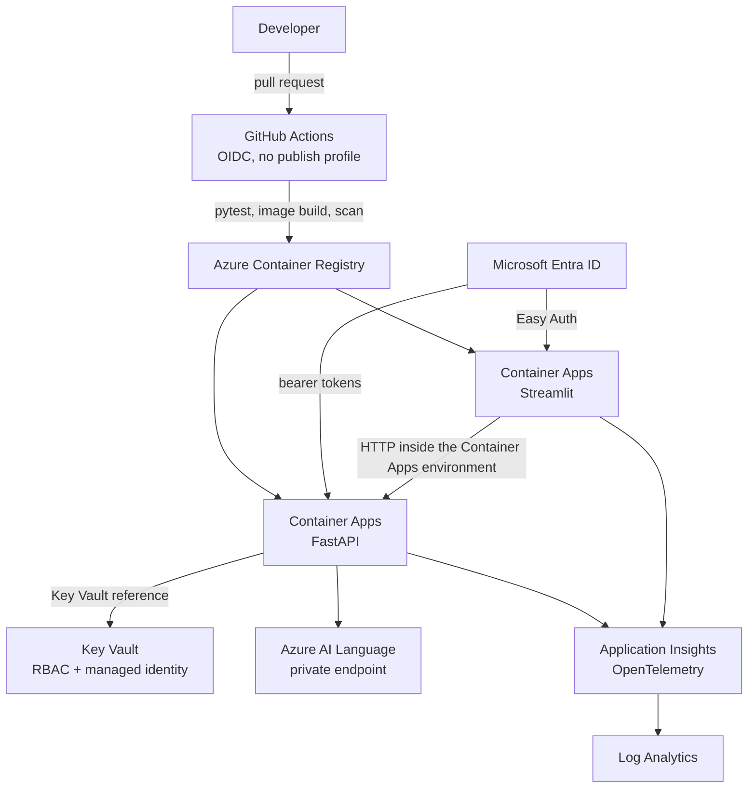

# Productionizing the Text & OCR Workbench

The Docker Compose stack is a local demo. It has no login, no secret store, and no private network path to Azure. This document is the concrete path from that demo to a deployment you can leave running. Do the steps in order. Each one removes a specific risk the current tree still has.



## 1. Rotate the credentials that were committed

`main.py` used to contain a live Language subscription key and an Application Insights instrumentation key. `utils.py` used to call `https://language-project.cognitiveservices.azure.com`. Those values are still in git history even though they are gone from the current tree. Anyone who can read the repository can read the old blobs.

Treat both secrets as compromised:

1. In the Azure portal, open the Language resource whose endpoint is `language-project.cognitiveservices.azure.com` (or whichever resource that host still points at).
2. On **Keys and Endpoint**, regenerate **Key 1** and **Key 2**.
3. Open the Application Insights resource that received logs from this app and rotate its connection string. If you cannot tell which resource it was, create a new Application Insights resource and stop using the old one.
4. Do not paste the old key into `.env`, App Service settings, or a GitHub secret "just to get it working again."

After rotation, the existing App Service (`text-analytics-fastapi`) will fail Azure calls until step 2 below is done. That is the safe failure. The API returns HTTP 502 for a rejected key and HTTP 503 when the settings are empty. It does not fall back to a baked-in key.

## 2. Give the current App Service a secret without committing one

The workflow `.github/workflows/main_text-analytics-fastapi.yml` deploys the API to Azure App Service on every push to `main`. It uses a publish profile stored as a GitHub secret. Keep that workflow only long enough to move off it. While it is still the deploy path, point the app at Key Vault instead of pasting keys into configuration.

Create a vault and a managed identity the app can use:

```bash
az group create --name rg-text-ocr --location eastus
az keyvault create \
  --name kv-text-ocr-<unique> \
  --resource-group rg-text-ocr \
  --location eastus \
  --enable-rbac-authorization true

az cognitiveservices account keys list \
  --name <language-resource> \
  --resource-group <language-resource-group>
```

Store only the new key:

```bash
az keyvault secret set \
  --vault-name kv-text-ocr-<unique> \
  --name azure-language-key \
  --value "<new key from the command above>"
```

Turn on a system-assigned identity for the existing app and grant it read access to secrets:

```bash
az webapp identity assign \
  --name text-analytics-fastapi \
  --resource-group <app-service-resource-group>

# principalId is in the JSON from the command above
az role assignment create \
  --role "Key Vault Secrets User" \
  --assignee-object-id <principalId> \
  --assignee-principal-type ServicePrincipal \
  --scope $(az keyvault show --name kv-text-ocr-<unique> --query id -o tsv)
```

App Service application settings, not the repo:

| Name | Value |
| --- | --- |
| `AZURE_LANGUAGE_ENDPOINT` | `https://<resource>.cognitiveservices.azure.com` |
| `AZURE_LANGUAGE_KEY` | `@Microsoft.KeyVault(VaultName=kv-text-ocr-<unique>;SecretName=azure-language-key)` |

The endpoint is not a secret. The key reference resolves at runtime through the managed identity. Confirm the setting shows a green Key Vault reference in the portal, then hit `POST /api/v1/analyze` and expect HTTP 200.

The App Service image is a code deploy, not the Docker image, so the `tesseract` binary is not there unless you add it. OCR will answer HTTP 503 with the install message until you move to the container in step 4. That message is the correct behavior. Do not apt-get over SSH on the app as a permanent fix.

Startup command stays:

```bash
gunicorn -w 2 -k uvicorn.workers.UvicornWorker main:app
```

## 3. Close the anonymous API before you share the URL

`text-analytics-fastapi` is unauthenticated. Anyone who can reach it can spend your Language quota and upload files for OCR. Put Microsoft Entra ID in front of it before sharing the host.

On the App Service: **Authentication** → add an identity provider → Microsoft → require authentication for unauthenticated requests. Use a new app registration, for example `text-ocr-api`. Restrict the app registration to accounts in your tenant.

For the later Container Apps deploy, use the same app registration:

- Streamlit ingress: Container Apps **Easy Auth** with that app registration, so a browser without a tenant login never loads the workbench.
- API ingress: require a bearer token. Set the API container to accept tokens whose audience is the API's application ID URI, `api://<api-client-id>`.
- Streamlit, running server-side, fetches a token with the user's session (Easy Auth forwards `X-MS-TOKEN-AAD-ACCESS-TOKEN`) and sends `Authorization: Bearer` to the API. Reject requests that arrive without it. Add that check in `app/main.py` behind an env flag such as `AUTH_REQUIRED=true` so the local Compose stack can keep running without Entra.

Service-to-service callers, if you add any later, get their own app registration and a client-credentials token. Do not ship a long-lived API key in a header as the primary control.

## 4. Build images in GitHub Actions and run them on Container Apps

The current workflow uploads the source tree and asks App Service to `pip install` it. Replace that with images you have already tested, pushed to Azure Container Registry by a workflow that does not store a password.

### Identity for GitHub

```bash
az identity create --name id-gha-text-ocr --resource-group rg-text-ocr
az acr create --name acrtextocr<unique> --resource-group rg-text-ocr --sku Basic

# Federated credential for pushes to main. GitHub exchanges an OIDC token
# for this identity, so the workflow does not store a client secret.
az identity federated-credential create \
  --name gha-main \
  --identity-name id-gha-text-ocr \
  --resource-group rg-text-ocr \
  --issuer https://token.actions.githubusercontent.com \
  --subject repo:ovokpus/Python-Azure-AI-REST-APIs:ref:refs/heads/main \
  --audiences api://AzureADTokenExchange

az role assignment create \
  --role AcrPush \
  --assignee-object-id $(az identity show -n id-gha-text-ocr -g rg-text-ocr --query principalId -o tsv) \
  --assignee-principal-type ServicePrincipal \
  --scope $(az acr show -n acrtextocr<unique> --query id -o tsv)
```

### Workflow shape

Replace `.github/workflows/main_text-analytics-fastapi.yml` with a workflow that:

1. Runs `pytest` on the pull request (`.github/workflows/test.yml` already does this, including a Compose boot).
2. On `main` only, logs in with `azure/login@v2` using `client-id`, `tenant-id`, and `subscription-id` — no client secret.
3. Runs `az acr login` and builds both Dockerfiles.
4. Pushes `text-ocr-api:<git-sha>` and `text-ocr-ui:<git-sha>`.
5. Deploys those tags to Container Apps.
6. Deletes the publish-profile GitHub secret after one green deploy. A publish profile is a password for the whole app.

A minimal deploy job after the images exist:

```yaml
permissions:
  id-token: write
  contents: read

steps:
  - uses: azure/login@v2
    with:
      client-id: ${{ secrets.AZURE_CLIENT_ID }}
      tenant-id: ${{ secrets.AZURE_TENANT_ID }}
      subscription-id: ${{ secrets.AZURE_SUBSCRIPTION_ID }}
  - uses: azure/container-apps-deploy-action@v2
    with:
      resourceGroup: rg-text-ocr
      containerAppName: ca-text-ocr-api
      imageToDeploy: acrtextocr<unique>.azurecr.io/text-ocr-api:${{ github.sha }}
```

`AZURE_CLIENT_ID` here is the client id of the user-assigned identity, not a secret. The federated credential is what makes the OIDC token valid. Do not also create a client secret "as a backup."

### Container Apps environment

One environment, two apps, one internal API:

```bash
az containerapp env create \
  --name cae-text-ocr \
  --resource-group rg-text-ocr \
  --location eastus

az containerapp create \
  --name ca-text-ocr-api \
  --resource-group rg-text-ocr \
  --environment cae-text-ocr \
  --image acrtextocr<unique>.azurecr.io/text-ocr-api:latest \
  --target-port 8000 \
  --ingress internal \
  --min-replicas 1 \
  --max-replicas 3 \
  --cpu 0.5 --memory 1.0Gi \
  --system-assigned

az containerapp create \
  --name ca-text-ocr-ui \
  --resource-group rg-text-ocr \
  --environment cae-text-ocr \
  --image acrtextocr<unique>.azurecr.io/text-ocr-ui:latest \
  --target-port 8501 \
  --ingress external \
  --min-replicas 1 \
  --max-replicas 2 \
  --env-vars API_BASE_URL=https://ca-text-ocr-api.internal.<env-domain>
```

Probe both apps with the paths the Dockerfiles already use:

| App | Path | Port |
| --- | --- | --- |
| API | `/health` | 8000 |
| UI | `/_stcore/health` | 8501 |

`/health` is liveness only. It stays 200 when Azure credentials are missing, so a bad Key Vault reference will not crash-loop the revision. Watch `/api/v1/status` from a scheduled check (or an alert on HTTP 503 from `/api/v1/analyze`) so a missing secret is visible.

Give `ca-text-ocr-api` a system-assigned identity, the **Key Vault Secrets User** role from step 2, and secret refs:

```bash
az containerapp secret set \
  --name ca-text-ocr-api \
  --resource-group rg-text-ocr \
  --secrets language-key=keyvaultref:https://kv-text-ocr-<unique>.vault.azure.net/secrets/azure-language-key,identityref:system

az containerapp update \
  --name ca-text-ocr-api \
  --resource-group rg-text-ocr \
  --set-env-vars AZURE_LANGUAGE_ENDPOINT=https://<resource>.cognitiveservices.azure.com \
  --replace-env-vars AZURE_LANGUAGE_KEY=secretref:language-key
```

Set the UI's `API_BASE_URL` to the API's internal ingress URL. Do not publish the API on a public port once the UI is the only caller.

The API image already runs as uid 10001 and already installs `tesseract-ocr`. Keep that. Do not switch the container to root to "make OCR easier."

## 5. Lock the Language resource to the virtual network

A key in Key Vault still works from any network that has the key. After Container Apps is up:

1. Create a virtual network and a private endpoint for the Language resource.
2. Disable public network access on the Cognitive Services account.
3. Put the Container Apps environment in that virtual network (workload profiles environment, or a regional environment with VNet injection).
4. Confirm `POST /api/v1/analyze` succeeds from the container and fails from a laptop that is not on the VPN. The laptop should keep using Compose with a dev Language resource, not the production key.

## 6. Observability that does not store your users' text

The demo logs to stdout: request method, path, status, and how many documents were analyzed. It does not log document text or the subscription key. Keep that rule in production. Hotel reviews and uploaded photos are customer content.

Wire OpenTelemetry to Application Insights. Install these in the API image when you take this step:

```text
azure-monitor-opentelemetry
opentelemetry-instrumentation-fastapi
```

Set one environment variable on both container apps, from Key Vault the same way as the Language key:

```bash
APPLICATIONINSIGHTS_CONNECTION_STRING=secretref:appinsights-connection-string
```

Instrument in `app/main.py` only when that variable is present, so local Compose stays quiet:

```python
import os

if os.getenv("APPLICATIONINSIGHTS_CONNECTION_STRING"):
    from azure.monitor.opentelemetry import configure_azure_monitor

    configure_azure_monitor()
```

Add these alerts on the Application Insights resource:

| Signal | Why |
| --- | --- |
| HTTP 5xx rate on the API above a handful in 5 minutes | Azure outage or a bug in a new image |
| HTTP 401/403 from the dependency call to `*.cognitiveservices.azure.com` | The Key Vault secret is the wrong key, or it was rotated and the reference is stale |
| CPU above 80% for 10 minutes on the API | Tesseract is burning a core per request; raise replicas or move OCR to Azure AI Vision |
| Language resource throttling (429) | Quota. Back off in `app/text_analytics.py` and request a quota increase |

Dependency tracking shows the outbound call to Language. Confirm a test request produces a dependency span and that the span's custom properties do not include the raw text. If you want a business event ("document analyzed"), log the sentiment label and the document length, not the document.

The UI container's stdout should be collected by the same Log Analytics workspace Container Apps uses by default. You do not need a second agent.

## 7. OCR at a scale Tesseract will not enjoy

Tesseract inside the API container is the right call for the demo and for light use. It has a hard ceiling: each request holds a CPU, there is no queue, and a 10 MB upload limit is the only guard. When that shows up in the CPU alert above, switch OCR to **Azure AI Vision Read** and keep Tesseract as the offline fallback behind a setting such as `OCR_BACKEND=vision|tesseract`.

That client should use the same managed identity (`DefaultAzureCredential`) against a Vision resource, not a second subscription key in the environment. The 503 path you already have is how the API should behave when Vision is not configured.

## 8. Hardening checklist before you call it done

These are small, and each one is still open:

- **Upload limits.** 10 MB per image is enforced in `app/ocr.py`. Add an ingress request-size limit on Container Apps to match, so the platform rejects a huge body before Python reads it.
- **Document content.** Text is forwarded to Azure Language, which is a processor under your Azure subscription. Say that on the Streamlit page before you let anyone outside the team use it. Do not write the text to disk. The current OCR path keeps the image in memory and does not save uploads into the repo (the old `fastapi-app` helper did).
- **Dependency scanning.** Enable Dependabot or `pip-audit` in the test workflow for `requirements.txt` and `requirements-ui.txt`. The pins are there so a scan has something stable to diff.
- **Image scanning.** After the ACR push, run `az acr task` with a scanner, or Microsoft Defender for Containers, and block deploy on high-severity findings.
- **CORS.** Leave it off. The browser talks to Streamlit, and Streamlit talks to the API server-side. A wide-open `CORSMiddleware` would undo the ingress split.
- **Replicas and the key.** Scale the API horizontally. The app holds no session state. Do not enable sticky sessions to paper over a bug.
- **Local `.env`.** Keep `.env` gitignored. Add a CI step that fails if a file named `.env` is tracked (`git ls-files .env`).
- **History.** Rotating the keys (step 1) matters more than rewriting git history. Rewriting history on `main` does not revoke the key. Do step 1 even if you never rewrite.

## What is already in place

You do not need to rebuild these for the demo:

- Graceful startup when Azure credentials are absent (HTTP 503 plus a message that names the variables).
- Placeholder values from `.env.example` treated as unset, so a copied template cannot accidentally call Azure.
- Health checks in both Dockerfiles and in `docker-compose.yml`.
- Non-root user in both images.
- Tests for the credential failure, a mocked Azure success, a rejected key, and OCR.
- A pull-request workflow that builds the images and smoke-tests them.

Production work starts at the key rotation, not at another rewrite of the UI.
