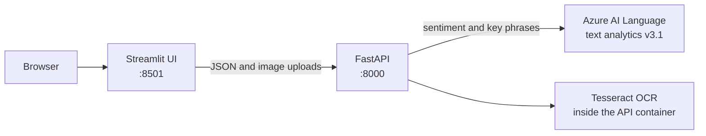
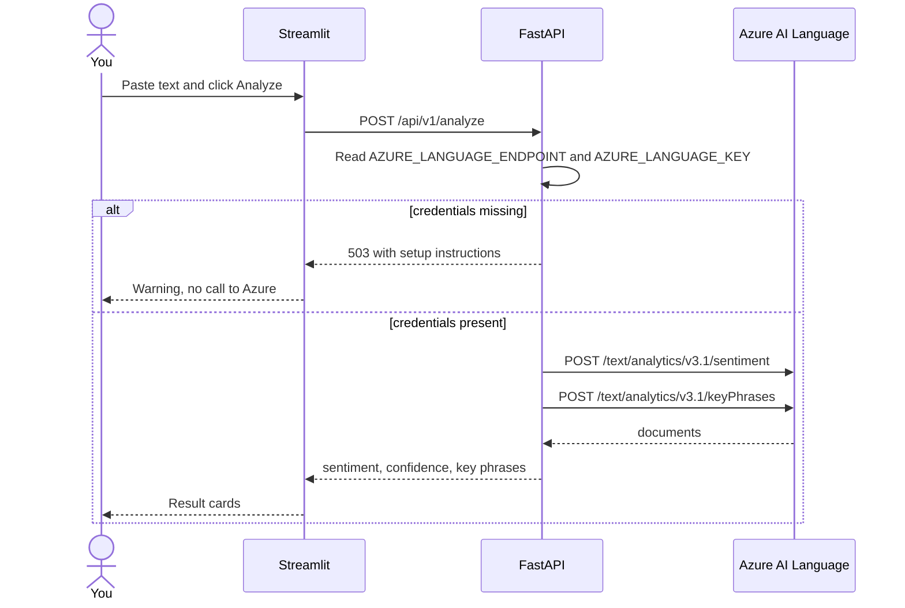
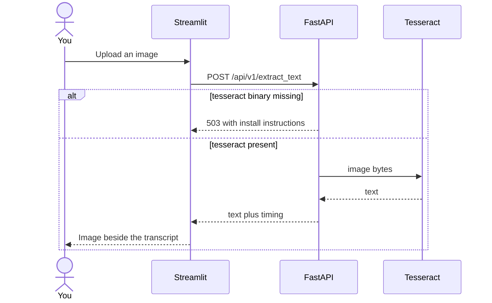

# Text & OCR Workbench

<p align="center"></p>

A small FastAPI service and a Streamlit UI for two jobs: score sentiment and pull key phrases with **Azure AI Language**, and read text out of images with **Tesseract**. Both run on your laptop with Docker Compose. Azure keys live in a `.env` file that is never committed. If those keys are missing, the app still boots and tells you exactly what to set.

---

## Business case

Hotels, retailers and service businesses collect more reviews and scanned forms than anyone has time to read. This workbench puts Azure AI Language sentiment and key phrases, plus local OCR, behind one small API and a Streamlit UI, so reviews can be triaged and images turned into text. At small volumes it fits mostly inside Azure's free monthly allowance. [docs/BUSINESS_CASE.md](docs/BUSINESS_CASE.md) covers the use cases, an illustrative ROI model and the limits.

## What you can do with it

- Paste a review (or a whole pile of them) and see sentiment, confidence, and key phrases.
- Drop in a PNG or JPEG and get the text back.
- Call the same routes from `curl` or `/docs` if you'd rather skip the UI.
- Run the original batch script over the sample hotel reviews once credentials are in place.

OCR does not call Azure. It uses the Tesseract binary installed in the API image, so it works with the key fields left blank.

---

## Architecture

The browser only talks to Streamlit. Streamlit only talks to FastAPI. FastAPI is the only process that sees the Azure key.



Text analysis, when credentials are present:



OCR never leaves the machine:



---

## How the project is put together

This is the path the code actually takes, from an empty checkout to a result on screen.

1. **One API, not three.** The repo used to boot two FastAPI apps (`main.py` for Azure text analytics, `fastapi-app/main.py` for OCR) plus a toy async demo (`fastapi-app/main2.py`). Those are now a single app in `app/main.py`. The root `main.py` only re-exports that app so the existing Azure App Service command `gunicorn -k uvicorn.workers.UvicornWorker main:app` still imports the right object.
2. **Configuration is read per request** from the environment in `app/config.py`. Accepted names are `AZURE_LANGUAGE_ENDPOINT` and `AZURE_LANGUAGE_KEY`. The older `COG_SERVICE_ENDPOINT` / `COG_SERVICE_KEY` pair still works. Placeholder values such as `your-key-here` count as unset.
3. **Text analytics** (`app/text_analytics.py`) posts to Azure AI Language REST `v3.1`, in batches of 10 documents. The response keeps the original `sentiment` and `keyphrases` arrays and adds a friendlier `results` list for the UI. The subscription key is sent as a header and is not logged.
4. **OCR** (`app/ocr.py`) opens the upload with Pillow and passes it to Tesseract. Files over 10 MB or files that are not images get a 400. A missing `tesseract` binary gets a 503 that tells you to use the Docker image.
5. **The UI** (`frontend/streamlit_app.py`) is a separate process. `frontend/api_client.py` is the only HTTP client it uses, which is why the same error strings show up in the browser and in `curl`.
6. **The batch script** (`text-analytics-sdk/text-analysis.py`) still walks `text-analytics-sdk/reviews/*.txt` and uses the Azure SDK. It shares `app/config.py`, so a missing key prints the same instructions and exits 1 instead of throwing a stack trace.
7. **Docker** builds two images from `Dockerfile` and `Dockerfile.frontend`. `docker-compose.yml` wires them together and publishes ports 8000 and 8501.

---

## Run it with Docker

You need Docker with Compose v2.

```bash
cp .env.example .env
```

Open `.env` and, when you have an Azure AI Language resource, set:

```bash
AZURE_LANGUAGE_ENDPOINT=https://<your-resource>.cognitiveservices.azure.com
AZURE_LANGUAGE_KEY=<key from the resource's Keys and Endpoint blade>
```

Blank values are valid. You can `docker compose up` before you create the Azure resource.

```bash
docker compose up --build
```

Then open:

| Surface | URL |
| --- | --- |
| Workbench UI | http://localhost:8501 |
| API docs | http://localhost:8000/docs |
| Health | http://localhost:8000/health |

## Demo

Leave the Azure fields in `.env` empty and walk the running stack once. This is the same path as a local screen recording of the Compose services: the UI, OCR on the sample image, the missing-key message, then the API docs.

1. Open http://localhost:8501. The page title is **Text & OCR Workbench**. One card says Azure Language credentials are not configured and names `AZURE_LANGUAGE_ENDPOINT` and `AZURE_LANGUAGE_KEY`. The other says Tesseract OCR is available.
2. Open the **Read an image** tab. Choose `samples/ocr-sample.png` and click **Extract text**. The picture sits beside the transcript. On this sample that transcript includes "The quick brown dog jumped over the lazy fox."
3. Open the **Analyze text** tab. Click **Load example review**, then **Analyze text**. A second card under the button repeats the configuration message. The API returns HTTP 503 and does not call Azure.
4. Open http://localhost:8000/docs. The Swagger page lists `/health`, `/api/v1/status`, `POST /api/v1/analyze`, and `POST /api/v1/extract_text`.

When you later paste a real endpoint and key into `.env` and run `docker compose up --build` again, step 3 returns sentiment and key phrases instead of that message.

Stop it with Ctrl+C, or `docker compose down` from another terminal.

The first build installs Python dependencies and the `tesseract-ocr` package. Later starts are just container boots.

### Try the API without the UI

No credentials:

```bash
curl -s -X POST http://localhost:8000/api/v1/analyze \
  -H 'content-type: application/json' \
  -d '{"text_to_analyze":["The rooms were spotless."]}'
```

You should get HTTP 503 and a message that names `AZURE_LANGUAGE_ENDPOINT` and `AZURE_LANGUAGE_KEY`.

OCR, using the sample image checked into the repo:

```bash
curl -s -F "images=@samples/ocr-sample.png" \
  http://localhost:8000/api/v1/extract_text
```

The body includes `results` (a list of filename and text) and the original filename-to-text map, plus `time_taken_seconds`.

With real credentials in `.env`, the same analyze `curl` returns sentiment and key phrases. Restart the stack after editing `.env` so Compose picks up the new values: `docker compose up --build`.

---

## Run it without Docker

Use Python 3.12. OCR on the host also needs the Tesseract binary (`sudo apt-get install tesseract-ocr` on Debian or Ubuntu).

```bash
python -m venv .venv
source .venv/bin/activate
pip install -r requirements-dev.txt
cp .env.example .env
# edit .env if you have Azure keys, then:
set -a && source .env && set +a

uvicorn app.main:app --reload --port 8000
```

In a second terminal, with the same virtualenv:

```bash
streamlit run frontend/streamlit_app.py
```

Streamlit defaults to `http://localhost:8000` for the API. Override it with `API_BASE_URL` if the API is somewhere else.

---

## Using the UI

1. The top of the page reports whether Azure Language is configured and whether Tesseract is installed. A warning there is the app working as designed, not a crash.
2. **Analyze text.** Paste copy, or click **Load example review**, pick a language, and click **Analyze text**. Each document comes back as a card: sentiment chip, confidence, key phrases. The raw JSON sits in an expander.
3. **Read an image.** Upload one or more PNG, JPEG, TIFF, BMP, WEBP, or GIF files (10 MB each) and click **Extract text**. The picture stays next to the transcript.

Colors are a light page with dark text. Sentiment chips use dark lettering on a tinted background so they stay readable.

---

## Batch reviews

Five sample reviews live in `text-analytics-sdk/reviews/`. The SDK script scores all of them in one go:

```bash
set -a && source .env && set +a
python text-analytics-sdk/text-analysis.py
```

Without keys, it prints the configuration message and exits 1. It does not open a connection to Azure.

---

## Tests

```bash
pip install -r requirements-dev.txt
pytest
```

The suite covers:

- health, status, and the legacy `POST /` route
- HTTP 503 with the setup message when Azure keys are missing or still placeholders
- a mocked Azure success path, including batches larger than 10 documents
- HTTP 502 when Azure rejects the key, without echoing the key
- OCR with Tesseract mocked, a non-image upload, an oversized upload, and the sample PNG when the `tesseract` binary is installed
- the UI client's error formatting
- the batch script's missing-credential exit

GitHub Actions (`.github/workflows/test.yml`) runs that suite and also builds the Compose stack, then checks health, the 503 analyze response, OCR on the sample image, and the Streamlit health endpoint.

`.github/workflows/main_text-analytics-fastapi.yml` still deploys **only the API** to the existing Azure App Service named `text-analytics-fastapi` on pushes to `main`. That service needs `AZURE_LANGUAGE_ENDPOINT` and `AZURE_LANGUAGE_KEY` in its application settings or text analysis will return 503. The UI is not part of that deploy. Replacing this workflow is the first hosting task in [PRODUCTIONIZING.md](PRODUCTIONIZING.md).

---

## Routes

| Method | Path | Purpose |
| --- | --- | --- |
| `GET` | `/health` | Liveness. Stays green when Azure is not configured. |
| `GET` | `/api/v1/status` | Whether Azure and Tesseract are ready. No secrets. |
| `POST` | `/api/v1/analyze` | Body: `{"text_to_analyze": ["..."], "language": "en"}`. Up to 25 documents, 5120 characters each. |
| `POST` | `/` | Same handler as `/api/v1/analyze`, for the original App Service clients. |
| `POST` | `/api/v1/extract_text` | Multipart field `images`, one or more files. |

`language` is a short code such as `en` or `zh-Hans`.

---

## Project layout

```text
app/                  FastAPI package (config, text analytics, OCR, routes)
frontend/             Streamlit UI and its API client
text-analytics-sdk/   Batch SDK script and sample reviews
samples/              ocr-sample.png used by tests and the curl example
tests/                pytest suite
Dockerfile            API image (Python 3.12 + tesseract-ocr)
Dockerfile.frontend   Streamlit image
docker-compose.yml    api + ui
.env.example          committed template, no real keys
PRODUCTIONIZING.md    what to do before this faces the public internet
```

---

## Keys, logs, and old entry points

- Real credentials belong in `.env` only. `.gitignore` already ignores that file. `.env.example` ships with empty values.
- An Azure subscription key and an Application Insights instrumentation key used to be hardcoded in `main.py`. They are gone from the tree. Treat them as compromised and rotate them. [PRODUCTIONIZING.md](PRODUCTIONIZING.md) has the steps. Do not put the old values back.
- Logs record status codes, document counts, and Azure HTTP failures. They do not record the subscription key or the document text.
- Removed as duplicate entry points: `fastapi-app/main.py`, `fastapi-app/main2.py`, `fastapi-app/ocr.py`, `fastapi-app/utils.py`, and the root `utils.py`. The sample OCR image moved to `samples/ocr-sample.png`.
